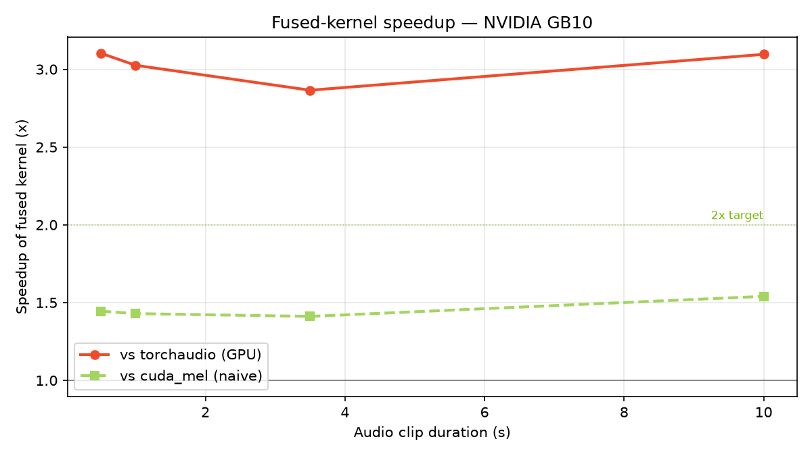
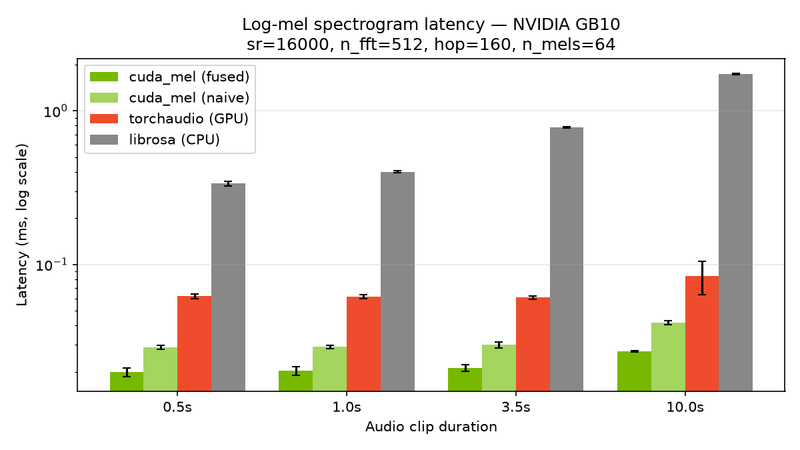

# cuda-mel-spectrogram

A fused STFT + mel filterbank CUDA kernel that computes log-mel spectrograms
**~3× faster than torchaudio's GPU path** on short audio clips, verified on an
NVIDIA GB10 (DGX Spark).



## Why

Log-mel spectrograms are the standard input feature for audio ML (keyword
spotting, cough detection, ASR front ends). torchaudio computes them on GPU as
a chain of **10 separate kernel launches** (pad → frame → window → FFT →
magnitude → mel matmul → log …), each writing intermediates to global memory.
For the short clips typical of edge-audio workloads (0.5–10 s), the pipeline is
launch-latency-bound, not compute-bound — Nsight Compute shows **~5% SM and
DRAM utilization**.

This project collapses the post-FFT stages (magnitude → mel projection → log)
into **one kernel**, keeping the power spectrum in shared memory so it never
touches DRAM, and exploits the compact triangular support of mel filters to
skip the dense matmul entirely:

| implementation | kernel launches / call | 3.5 s clip latency (GB10) |
|---|---|---|
| torchaudio (GPU) | 10 | 60.8 µs |
| ours, naive (cuFFT + cuBLAS, separate kernels) | 7 | 30.0 µs |
| **ours, fused** | **4** | **21.2 µs** |

librosa on CPU: 781 µs for the same clip (37× slower than fused).

## Pipeline

```
waveform ──► reflection pad (ATen)
         ──► frame + Hann window        [custom kernel]
         ──► batched real-to-complex FFT [cuFFT, one plan for all frames]
         ──► magnitude² + mel projection + log(x+ε)   [ONE fused kernel]
```

The fused kernel launches one thread block per STFT frame:

1. **Phase 1** — threads cooperatively compute `|FFT|²` for the frame's
   `n_fft/2+1` bins directly into shared memory (coalesced reads, no global
   write).
2. **Phase 2** — after a barrier, each thread owns one or more mel filters and
   computes a sparse dot product over just that filter's nonzero bin range
   (CSR-style `weights/offsets/start_bin` arrays, read via `__ldg`), then
   applies `log(x+ε)` and writes the single output value.

The mel filterbank matches `torchaudio` exactly (HTK mel scale, `norm=None`);
output agrees with `torchaudio.transforms.MelSpectrogram` to **max abs error
~2×10⁻⁵** across all tested configs.

## Install

Requires: CUDA toolkit (tested 13.0), PyTorch with CUDA, a GPU.

```bash
pip install torch --index-url https://download.pytorch.org/whl/cu130  # if needed
pip install --no-build-isolation .
```

## Use

```python
import torch, cuda_mel

mel = cuda_mel.MelSpectrogramCUDA(
    sample_rate=16000, n_fft=512, hop_length=160, n_mels=64).cuda()

waveform = torch.randn(16000 * 3, device="cuda")   # 3 s of audio
log_mel = mel(waveform)                             # (num_frames, n_mels)
```

`fused=False` selects the naive multi-kernel path (cuFFT + cuBLAS), useful as
a baseline.

## Reproduce the results

```bash
PYTHONPATH=python python tests/test_correctness.py     # vs torchaudio
PYTHONPATH=python python bench/benchmark.py --iters 100 --out bench/results
PYTHONPATH=python python bench/make_plots.py           # figures -> docs/figures
```

Benchmark method: 20 warmup iterations, then 100 timed iterations using CUDA
events with per-iteration synchronize; mean ± std reported. cuFFT plans are
cached (steady-state serving scenario), matching torchaudio's own plan cache.



## Results (NVIDIA GB10, CUDA 13.0, torch 2.12.1)

| clip | fused | naive | torchaudio GPU | librosa CPU | speedup vs torchaudio |
|---|---|---|---|---|---|
| 0.5 s | 20.0 µs | 28.9 µs | 62.1 µs | 336 µs | **3.10×** |
| 1.0 s | 20.4 µs | 29.1 µs | 61.7 µs | 401 µs | **3.02×** |
| 3.5 s | 21.2 µs | 30.0 µs | 60.8 µs | 781 µs | **2.87×** |
| 10 s | 27.1 µs | 41.8 µs | 84.0 µs | 1735 µs | **3.10×** |

Config: sr=16000, n_fft=512, hop=160, n_mels=64 (typical cough/keyword
front-end settings).

Nsight Compute, fused kernel on a 3.5 s clip: 12.4 µs duration, 351 blocks ×
256 threads, 35 registers/thread, 60% achieved occupancy, ~5% SM / memory
throughput — the workload is launch-bound, which is precisely why reducing 10
launches to 4 (and skipping two intermediate DRAM round trips) dominates.

## Layout

```
src/kernels.cu        CUDA kernels (framing/window, magnitude, log, fused)
src/bindings.cpp      torch extension bindings, cuFFT plan cache, cuBLAS path
python/cuda_mel/      Python package (MelSpectrogramCUDA, mel filterbank)
tests/                correctness vs torchaudio
bench/                benchmark + plotting scripts
docs/note/            2-page technical note (LaTeX + PDF)
docs/figures/         generated figures
```

## Technical note

A 2-page write-up with implementation details and profiling analysis:
[docs/note/note.pdf](docs/note/note.pdf).
